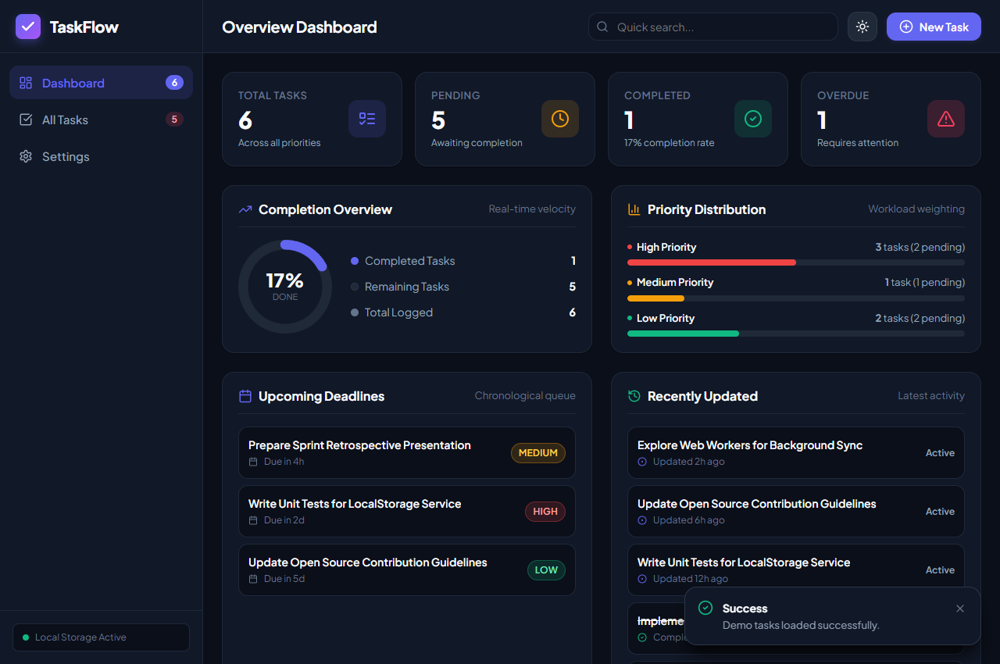
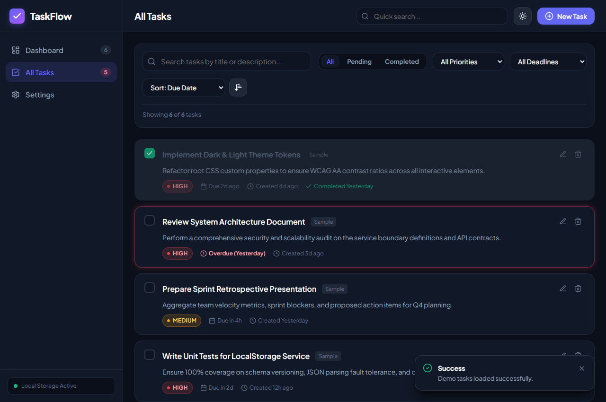
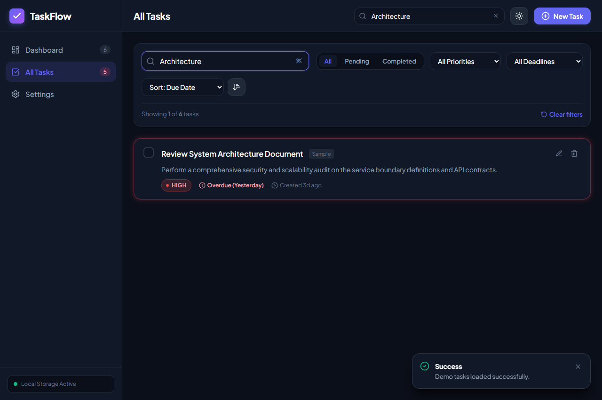
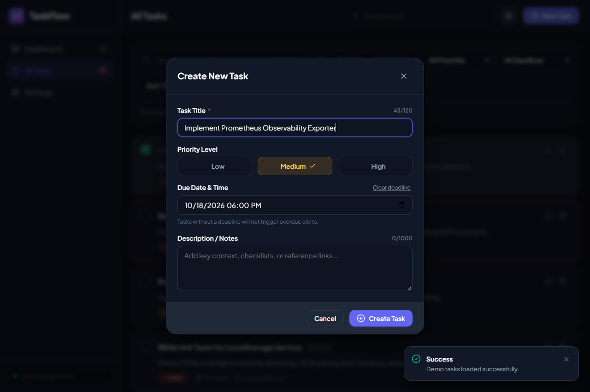
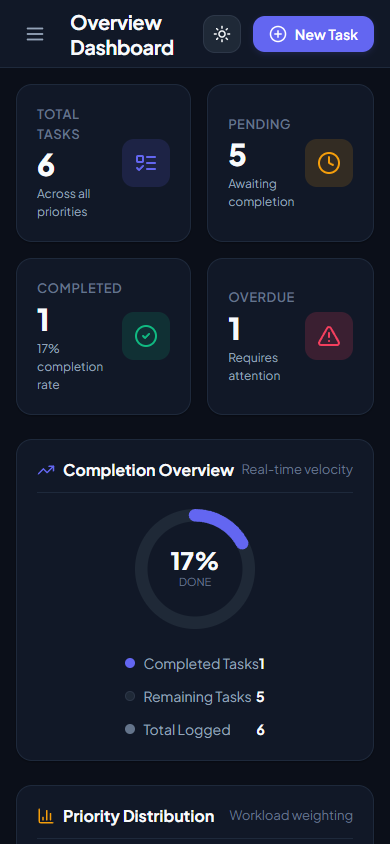
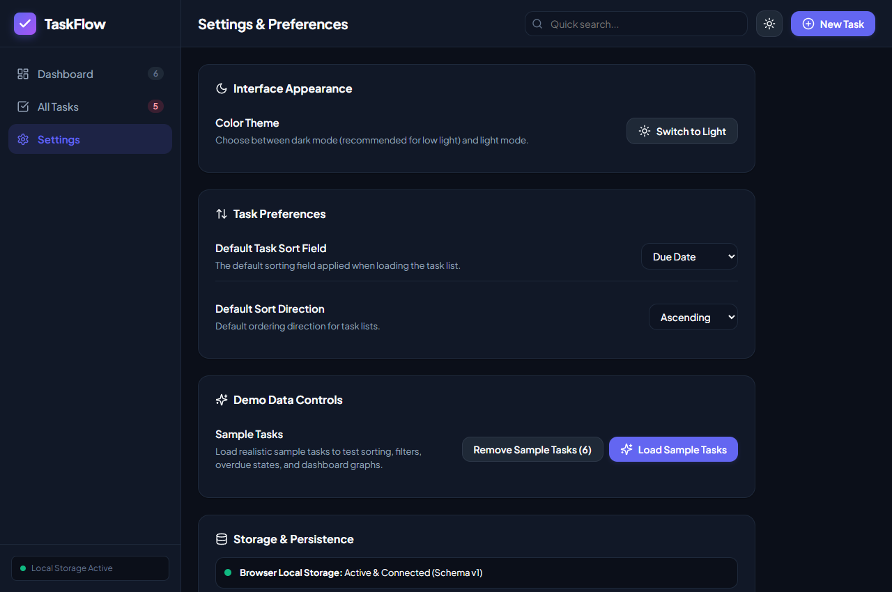

# TaskFlow — Modern Productivity & Task Management Web Application

> A complete, polished, production-grade task management web application engineered for the Full Stack Web Development / MERN Stack curriculum. Built with React 18, Vite, modern ES modules, semantic HTML5, responsive CSS3 design tokens, and a resilient browser Local Storage persistence layer.

---

## Table of Contents

1. [Project Overview & Mission](#project-overview--mission)
2. [Key Objectives](#key-objectives)
3. [Architecture & Technology Stack](#architecture--technology-stack)
4. [Core Features](#core-features)
5. [User Interface & Visual Design](#user-interface--visual-design)
6. [Data Model & Local Storage Architecture](#data-model--local-storage-architecture)
7. [Screenshots](#screenshots)
8. [Project Structure](#project-structure)
9. [Prerequisites & Getting Started](#prerequisites--getting-started)
10. [Automated Testing & QA Verification](#automated-testing--qa-verification)
11. [Vercel Deployment Guide](#vercel-deployment-guide)
12. [Known Limitations & Future Roadmap](#known-limitations--future-roadmap)

---

## Project Overview & Mission

**TaskFlow** is designed as a frontend-focused task management system that delivers a desktop and mobile experience without relying on cloud backends or third-party authentication services. 

Rather than serving as a static prototype or mock interface, TaskFlow provides a complete, functional client-side workflow. It enables users to create, view, edit, organize, filter, search, sort, and permanently track tasks with real-time analytics. All task data and user preferences are persisted in browser Local Storage with fault tolerance, schema versioning, and recovery mechanisms for corrupted data.

---

## Key Objectives

- **Complete Task Lifecycle Management**: Support full CRUD workflows (Create, Read, Update, Delete) with validation and deletion confirmations.
- **Client-Side Persistence**: Implement an isolated Local Storage service that persists tasks and user preferences across browser sessions without silent data loss.
- **Real-Time Analytics Dashboard**: Derive statistical insights directly from task data, including total volume, pending count, completed count, overdue counts, completion percentage, priority distribution, upcoming deadlines, and recent activity.
- **Cohesive Design System**: Provide dark and light themes (dark mode initial preference), custom CSS variables, accessible color contrasts (WCAG AA), responsive breakpoints, and reduced-motion considerations.
- **Production Readiness**: Provide 100% passing automated test coverage using Vitest and React Testing Library, an optimized Vite build pipeline, and deployment configuration for Vercel.

---

## Architecture & Technology Stack

| Layer | Technology | Rationale & Responsibility |
| :--- | :--- | :--- |
| **Framework** | **React.js 18.3.1** | Component architecture, state management via Context & Custom Hooks (`useTasks`, `useTheme`, `useToast`). |
| **Build Tool** | **Vite 6.1.1** | Ultra-fast HMR (Hot Module Replacement), optimized ES module bundling, tree-shaking, and minified production builds. |
| **Styling** | **Modern CSS3 & Tokens** | Coherent design system utilizing CSS custom properties, responsive flexbox/grid layouts, and accessibility focus indicators. |
| **Icons** | **Lucide React 0.475** | Accessible SVG iconography for UI controls and priority status indicators. |
| **Persistence** | **Browser Local Storage** | Structured client-side key-value persistence with schema versioning (`v1`), quota guard, and corrupted data backup. |
| **Testing** | **Vitest 3.0.6 + RTL** | Fast unit and integration testing suite with jsdom, testing state, validation, storage fault-tolerance, and DOM interactions. |
| **Hosting Target**| **Vercel** | Single-page application (SPA) static deployment with rewrite rules defined in `vercel.json`. |

---

## Core Features

### 1. Real-Time Overview Dashboard
- **Key Metrics Row**: Displays real-time counts for **Total Tasks**, **Pending Tasks**, **Completed Tasks**, and **Overdue Tasks**.
- **Interactive Completion Ring**: SVG-based radial progress indicator calculating live completion velocity percentage.
- **Priority Distribution Breakdown**: Visual workload weighting across **High**, **Medium**, and **Low** priorities with pending task ratios.
- **Upcoming Deadlines Queue**: Chronological list of imminent pending deadlines within the upcoming days.
- **Recent Activity Feed**: Real-time audit log of recently modified or completed tasks.
- **Empty State & Demo Loader**: Welcomes new users with one-click sample task generation or custom task creation.

### 2. Advanced Task List, Search & Multi-Filters
- **Full-Text Instant Search**: Filters in real-time across task titles and descriptions.
- **Completion Status Tabs**: Filter by *All*, *Pending*, or *Completed*.
- **Priority Selectors**: Filter by *High*, *Medium*, or *Low* priority.
- **Deadline Category Filter**: Filter by *Overdue*, *Due Today*, *Due This Week*, *Upcoming (Later)*, or *No Due Date*.
- **Multi-Field Sorting**: Sort by *Due Date*, *Priority Weight*, *Creation Timestamp*, or *Alphabetical Title* with an **Ascending/Descending** toggle.
- **Filter Composition**: Search, status, priority, and date filters compound seamlessly without clobbering one another.
- **Reset Filters**: One-click filter reset button when any filter or query is active.

### 3. Task Creation & Validation Modal
- **Field Validation**:
  - Title: Required, trimmed, minimum 2 characters, maximum 120 characters, rejection of whitespace-only strings.
  - Accidental Duplicate Warning: Flags active pending tasks sharing the exact same title.
  - Priority: Required selection with sensible default (`Medium`).
  - Due Date & Time: HTML5 `datetime-local` picker; validates that deadlines cannot precede task creation timestamps.
  - Description: Optional rich context/checklist notes (up to 1,000 characters).
- **Subtle Feedback**: Real-time feedback with inline error states and non-blocking toast notifications.

### 4. Task Editing & State Transitions
- **In-Place Prepopulation**: Modals open pre-filled with the selected task's current title, priority, due date, and notes.
- **Timestamp Integrity**: Preserves original `createdAt` timestamp while updating `updatedAt` for activity tracking.
- **Instant Status Toggles**: Single-click checkbox on cards toggles `pending` $\leftrightarrow$ `completed` with a visual strikethrough, setting or clearing `completedAt` timestamps and refreshing dashboard metrics.

### 5. Safe Deletion & Data Protection
- **Explicit Confirmation Modal**: Prevents accidental deletions by presenting a modal identifying the specific task title being removed with explicit **Cancel** and **Delete Task** actions.
- **Two-Step Bulk Wipe**: Settings provides a "Danger Zone" option requiring users to type `CLEAR` to permanently erase all stored tasks.

### 6. Settings, Themes & Preferences
- **Dark/Light Theme Toggle**: Seamless transition between dark and light themes with persistence to Local Storage.
- **Default Sort Preference**: Users can configure default sorting field and direction for future sessions.
- **Demo Data Controls**: Instant sample data loader with safe "Remove Sample Tasks" action that preserves custom user-created tasks.

---

## User Interface & Visual Design

- **Dark Mode Initial Preference**: Configured with a deep, low-eye-strain slate palette (`#0b0f19` and `#111827`).
- **Priority Indicators**:
  - **High**: Vivid red badge (`--priority-high-dot: #ef4444`) with high-contrast text and border.
  - **Medium**: Warm amber badge (`--priority-med-dot: #f59e0b`).
  - **Low**: Crisp emerald badge (`--priority-low-dot: #10b981`).
- **Overdue Visual Treatment**: Uncompleted tasks past their deadline feature a glowing crimson border (`--status-overdue-border`) and warning badges.
- **Accessibility & Responsiveness**:
  - Full WCAG AA color contrast compliance.
  - Standard `:focus-visible` outline rings for keyboard accessibility.
  - Dedicated media queries collapsing desktop sidebars into a mobile navigation drawer on screens $\le 1024\text{px}$.
  - Reduced-motion media query (`prefers-reduced-motion: reduce`) disabling transitions for users with vestibular sensitivities.

---

## Data Model & Local Storage Architecture

### Task Schema (JSON)
```json
{
  "id": "task-1729173000000-abc1234",
  "title": "Conduct Security Architecture Review",
  "description": "Audit microservice contracts, IAM policies, and ingress filters.",
  "priority": "high",
  "status": "pending",
  "createdAt": "2026-10-17T12:00:00.000Z",
  "updatedAt": "2026-10-17T12:30:00.000Z",
  "dueDate": "2026-10-20T18:00:00.000Z",
  "completedAt": null,
  "isDemo": false
}
```

### Storage Resilience Strategy
1. **Isolated Service Layer (`storageService.js`)**: Encapsulates all `window.localStorage` interactions inside error-handled routines.
2. **Schema Versioning**: Stored payloads wrap tasks in an envelope `{ version: 1, updatedAt: '...', tasks: [...] }`.
3. **Corrupted Data Protection**: If malformed JSON is found, TaskFlow does **not** erase the file. Instead, it backs up the raw string to `taskflow_corrupt_backup_<timestamp>` and alerts the user with a recoverable notification.
4. **Quota & Environment Handling**: Gracefully catches `QuotaExceededError` and handles restricted/private browsing modes where Local Storage is disabled.
5. **Browser-Specific Scope**: Local Storage is bound to the user's specific browser and device. It does not sync across different devices or incognito sessions.

---

## Screenshots

Genuine screenshots captured directly from the running production application:

| View | Screenshot |
| :--- | :--- |
| **Overview Dashboard** |  |
| **All Tasks & Statuses** |  |
| **Search & Filtering** |  |
| **Task Creation Modal** |  |
| **Mobile Responsive View**|  |
| **Settings & Preferences**|  |

---

## Project Structure

```
TaskFlow/
├── .gitignore                   # Git exclusion rules for node_modules, dist, logs
├── index.html                   # HTML5 entrypoint with Google Fonts and meta tags
├── package.json                 # Project dependencies, scripts, and engine specs
├── vercel.json                  # Vercel deployment and SPA rewrite rules
├── vite.config.js               # Vite bundler and Vitest jsdom test runner config
├── README.md                    # Project documentation
├── Project_Report.md            # Comprehensive MERN Minor Project Report source
├── Project_Report.pdf           # Formatted PDF Project Report
├── public/
│   └── favicon.svg              # Brand SVG vector icon
├── screenshots/                 # Authentic captures of running application
│   ├── 01-dashboard.png
│   ├── 02-task-list.png
│   ├── 03-search-filter.png
│   ├── 04-task-modal.png
│   ├── 05-mobile-view.png
│   └── 06-settings-view.png
└── src/
    ├── App.jsx                  # Root App component integrating providers
    ├── main.jsx                 # React 18 DOM bootstrapping
    ├── components/
    │   ├── common/              # Reusable UI primitives
    │   │   ├── Badge.jsx        # Status and priority badges
    │   │   ├── Button.jsx       # Accessible buttons with variants and icons
    │   │   ├── Card.jsx         # Surface container card
    │   │   ├── EmptyState.jsx   # Contextual empty state illustrations
    │   │   ├── Modal.jsx        # Accessible dialog with focus trap & Esc key
    │   │   └── Toast.jsx        # Floating notifications container
    │   ├── dashboard/           # Analytics widgets
    │   │   ├── Dashboard.jsx    # Main dashboard view
    │   │   ├── MetricCard.jsx   # Top-level metric cards
    │   │   ├── PriorityBreakdown.jsx # Priority distribution bar graph
    │   │   ├── ProgressRing.jsx # SVG circular progress meter
    │   │   ├── RecentActivity.jsx    # Latest updates audit list
    │   │   └── UpcomingDeadlines.jsx # Imminent deadline queue
    │   ├── dialogs/             # Modal dialogs
    │   │   ├── ClearAllDialog.jsx    # Two-step strong confirmation dialog
    │   │   ├── DeleteConfirmDialog.jsx # Explicit single task deletion dialog
    │   │   └── TaskFormModal.jsx     # Creation & editing form with validation
    │   ├── layout/              # Structural chrome
    │   │   ├── AppLayout.jsx    # Shell layout with views and modals
    │   │   ├── Header.jsx       # Sticky header with search, theme, and actions
    │   │   └── Sidebar.jsx      # Navigation sidebar with dynamic badges
    │   ├── settings/
    │   │   └── SettingsView.jsx # Appearance, sorting, demo data, and storage
    │   └── tasks/               # Task management components
    │       ├── TaskCard.jsx     # Individual task card with status & metadata
    │       ├── TaskFilters.jsx  # Status tabs, priority & date filter dropdowns
    │       ├── TaskList.jsx     # Filtered list container with summary toolbar
    │       ├── TaskSearchBar.jsx# Debounced search bar with clear button
    │       └── TaskSort.jsx     # Sort field select and order toggle button
    ├── context/
    │   ├── TaskContext.jsx      # Global task state, CRUD, filters, and stats
    │   └── ThemeContext.jsx     # Dark/light theme state & DOM synchronization
    ├── hooks/
    │   ├── useTasks.js          # Custom hook for task context
    │   ├── useTheme.js          # Custom hook for theme context
    │   └── useToast.js          # Custom hook for toast notifications
    ├── services/
    │   └── storageService.js    # Resilient Local Storage abstraction layer
    ├── styles/
    │   ├── components.css       # Layout, widget, form, and dialog CSS
    │   ├── index.css            # Base reset, typography, and scrollbars
    │   └── variables.css        # Design tokens for dark/light themes
    ├── test/
    │   ├── setup.js             # Vitest test setup and matchMedia polyfill
    │   ├── components.test.jsx  # Integration tests for UI workflows
    │   ├── dateUtils.test.js    # Unit tests for overdue & date utilities
    │   ├── filterSortUtils.test.js # Unit tests for search, filter & sort
    │   ├── storageService.test.js  # Tests for persistence and corrupt recovery
    │   └── validators.test.js   # Unit tests for form input rules
    └── utils/
        ├── constants.js         # Priorities, statuses, storage keys, filters
        ├── dateUtils.js         # Formatting, relative time, overdue logic
        ├── filterSortUtils.js   # Search, filter, sorting, and metric algorithms
        ├── sampleData.js        # Dynamic demo task generator
        └── validators.js        # Task validation and duplicate detection
```

---

## Prerequisites & Getting Started

### Prerequisites
- **Node.js**: `v18.0.0` or later (tested on Node `v22.21.0`).
- **npm**: `v9.0.0` or later (tested on npm `v11.11.0`).

### Installation
1. Clone the repository:
   ```bash
   git clone https://github.com/your-username/TaskFlow.git
   cd TaskFlow
   ```
2. Install dependencies:
   ```bash
   npm install
   ```

### Running Locally (Development Mode)
Start the Vite development server with Hot Module Replacement:
```bash
npm run dev
```
Open your browser and navigate to `http://localhost:5173/`.

### Building for Production
Compile minified, optimized production assets into the `dist/` directory:
```bash
npm run build
```

### Previewing Production Build
Serve the production bundle locally to test production behavior:
```bash
npm run preview
```
Visit `http://localhost:4173/`.

---

## Automated Testing & QA Verification

TaskFlow includes an automated test suite executed with Vitest and React Testing Library.

Run the test suite once:
```bash
npm test
```

Run tests in watch mode during development:
```bash
npm run test:watch
```

### Test Suite Results

```
 RUN  v3.2.7 C:/Users/gaumi/Documents/GitHub/TaskFlow

 ✓ src/test/validators.test.js (6 tests)
 ✓ src/test/dateUtils.test.js (11 tests)
 ✓ src/test/storageService.test.js (5 tests)
 ✓ src/test/filterSortUtils.test.js (10 tests)
 ✓ src/test/components.test.jsx (8 tests)

 Test Files  5 passed (5)
      Tests  40 passed (40)
   Duration  11.15s
```

All 40 automated tests across 5 test suites pass with 100% success rate:
- **Validation**: Title presence, whitespace rejection, length caps, priority enum checking, due date chronological ordering, and duplicate warnings.
- **Date Utilities**: Accurate overdue calculations (completed tasks are never overdue, tasks without due dates are never overdue, past due dates flag overdue).
- **Filter & Sort**: Multi-condition search across title/description, status filtering, priority filtering, deadline category filtering, and stable sorting.
- **Storage Layer**: Schema versioning, normal persistence, backup key generation on corrupted JSON strings, and theme persistence.
- **Component Workflows**: Task creation modal, edit flow preserving `createdAt`, deletion confirmation dialog with explicit cancellation, status toggle, search bar clear, and theme switching.

---

## Vercel Deployment Guide

TaskFlow is configured for one-click deployment on [Vercel](https://vercel.com).

### Step-by-Step Deployment Instructions

1. **Push to GitHub**:
   Ensure all changes are committed and pushed to your GitHub repository:
   ```bash
   git add .
   git commit -m "feat: complete TaskFlow minor project implementation"
   git push origin main
   ```

2. **Import Repository in Vercel**:
   - Log in to your [Vercel Dashboard](https://vercel.com/dashboard).
   - Click **Add New...** $\rightarrow$ **Project**.
   - Select your Git provider (GitHub) and import `TaskFlow`.

3. **Configure Project Settings**:
   - **Framework Preset**: `Vite` (automatically detected).
   - **Build Command**: `npm run build` (or `vite build`).
   - **Output Directory**: `dist`.
   - **Install Command**: `npm install`.

4. **Deploy**:
   - Click **Deploy**. Vercel will build the project in approximately 20–30 seconds.
   - Once deployed, your production URL (e.g., `https://taskflow-[id].vercel.app`) will be live.

5. **Continuous Deployment**:
   Any subsequent commit pushed to the `main` branch will automatically trigger a new preview and production deployment on Vercel.

---

## Known Limitations & Future Roadmap

- **Browser Storage Isolation**: TaskFlow utilizes browser Local Storage as specified in project requirements. Data does not synchronize across different browsers or physical devices.
- **Future Cloud Sync**: An optional backend sync layer (e.g., Node.js/Express with MongoDB) could be added to provide multi-device synchronization via JWT authentication.
- **Subtask & Checklist Hierarchy**: Future enhancements can support nested subtasks with progress tracking.
- **Drag-and-Drop Kanban View**: An alternative board view with drag-and-drop column transitions between Pending, In Progress, and Completed.
- **Calendar View**: A visual monthly/weekly calendar grid mapping task deadlines.